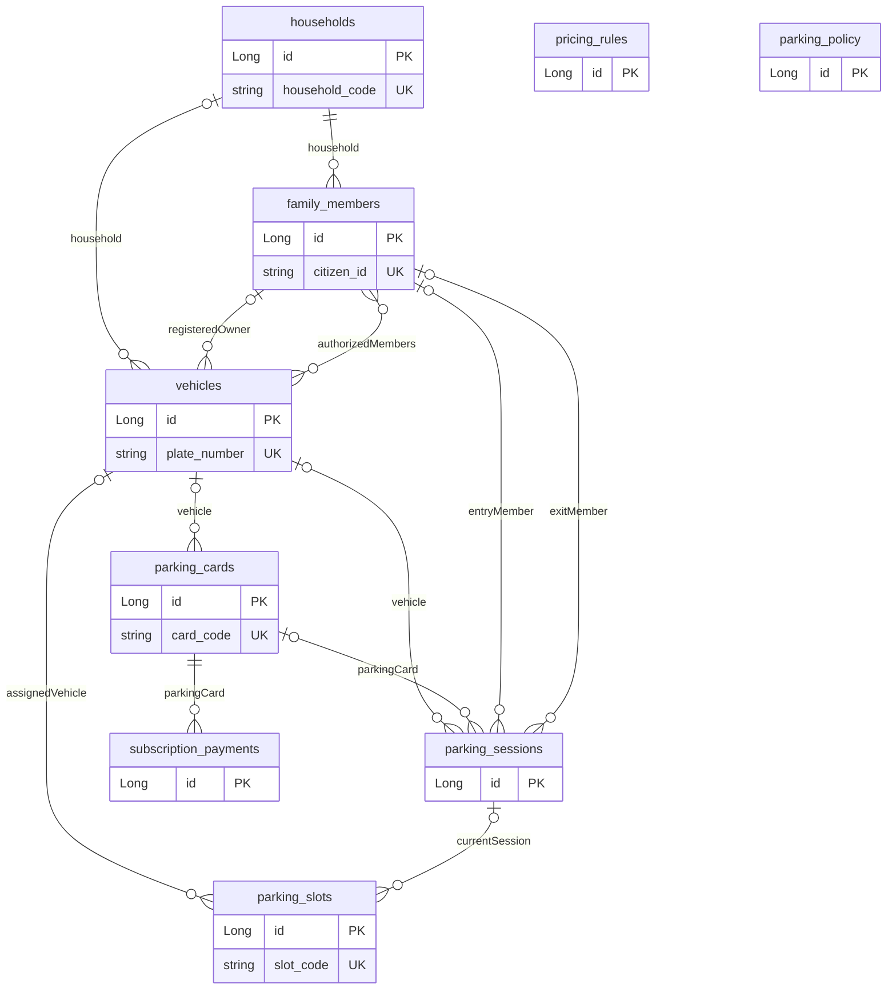

# Database — JPA mappings, quan hệ và giới hạn integrity

[Kiến trúc hệ thống](system.md) · [Phạm vi nghiệp vụ](../requirements/README.md) · [Traceability](../requirements/traceability.md) · [NV02](../requirements/nv02-cards-passes-pricing.md) · [NV08](../requirements/nv08-reporting.md)

[ERD tổng quan/nghiệp vụ/security/payment](erd.md) và [data dictionary toàn bộ 20 entities/hai bảng nối](data-dictionary.md) sở hữu danh mục field/constraint của `main` (`abd6183`); trang này tập trung lifecycle và integrity boundaries.

## Mức bằng chứng và database technology

Trang này mô tả **JPA/entity-level mappings** và các SQL scripts thủ công trong source; không phải schema introspection hoặc production migration evidence. Annotation nullable/unique/precision là metadata cho ORM; chưa chứng minh mọi constraint/index/FK được tạo/enforced trên database triển khai. Những tên field không ghi `@Column(name=...)` được trình bày theo **Java property**, không tự invent tên SQL/naming strategy.

- [pom.xml](../../spring-web/pom.xml) dùng Spring Boot3.5.5/Java21/Spring Data JPA; MySQL connector runtime, H2 **test scope**. Có driver không chứng minh datasource deployed.
- Main không có Flyway dependency, `application.yml` hoặc `resources/db/migration`. SQL ở [scripts/database](../../scripts/database/) gồm account/audit, Desktop sessions, shifts, dynamic RBAC/employee profile, evidence/assets/manual corrections, payment và idempotency; không tự chạy scripts khi đọc docs hoặc khởi động theo giả định Flyway.
- [application.properties](../../spring-web/src/main/resources/application.properties) khai MySQL driver/dialect, datasource từ `PARKING_DB_URL`/`PARKING_DB_USERNAME`/`PARKING_DB_PASSWORD`, `spring.jpa.hibernate.ddl-auto=update`, open-in-view=false. Đây là source default, không effective configuration hay proof DDL đã áp dụng; local/profile overrides có thể khác.
- [ParkingFlowIntegrationTest](../../spring-web/src/test/java/vn/edu/parking/ParkingFlowIntegrationTest.java) là H2 integration source. Các kết quả 128/128/V1–V6 H2 rehearsal trong tài liệu nhánh trước là **legacy**, không kết quả main hiện tại. Lượt docs-only này không chạy test/SQL hoặc truy cập DB.
- Production datasource/profile/naming/collation/timezone và tình trạng scripts vẫn **Not verified**. Nhãn launcher/SQL comment Aiven không proof kết nối hay môi trường thực tế. Không chép credentials hoặc giá trị secret.

## Registry entities, tables và key fields

Chín entity nghiệp vụ nền dưới đây có `Long id @Id`; tám entity dùng IDENTITY, riêng ParkingPolicy không generated, Java default id1. Defaults Java không tự là SQL DEFAULT. Nhóm bổ sung có @Version/@Index được mô tả riêng, không áp nhận xét “không có version/lock” cho toàn model.

| Entity / table / exact source | Fields quan trọng và metadata khai báo |
| --- | --- |
| [Household](../../spring-web/src/main/java/vn/edu/parking/domain/Household.java):6–26 → `households` | `household_code` unique/not-null/length40; apartmentNumber not-null/40, buildingName/contactPhone/quota overrides/active; explicit `created_at`, @PrePersist nếu null |
| [FamilyMember](../../spring-web/src/main/java/vn/edu/parking/domain/FamilyMember.java):6–34 → `family_members` | `citizen_id` unique/length20 **không nullable=false**; fullName not-null; household bắt buộc; CCCD raw/id/fields/image path + registrationFaceImagePath length500, active. Không copy dữ liệu cá nhân |
| [Vehicle](../../spring-web/src/main/java/vn/edu/parking/domain/Vehicle.java):9–52 → `vehicles` | `plate_number` unique/not-null/20; ownerName not-null, legacy ownerPhone/apartmentNumber; household/registeredOwner/authorizedMembers; vehicleType STRING not-null/varchar50; registration/hãng/dòng/color/year/chassis/engine/seats/cylinderCapacityCc/fuel/path/active/created_at |
| [ParkingCard](../../spring-web/src/main/java/vn/edu/parking/domain/ParkingCard.java):7–25 → `parking_cards` | `card_code` unique/not-null/30; vehicle optional; status STRING not-null/Java ACTIVE; passType STRING/default PER_VISIT, validFrom/Until, subscriptionFee precision12 scale0. Không MonthlyPass entity riêng tại mapping này |
| [ParkingSession](../../spring-web/src/main/java/vn/edu/parking/domain/ParkingSession.java):7–43 → `parking_sessions` | entryPlate/entryTime/status/fee not-null; exitPlate/time; vehicle/card/entryMember/exitMember optional; detectedVehicleType STRING/varchar50; fee(12,0); manualOverride và face flags not-null/boolean default false declaration; face scores và entryFaceImagePath500 |
| [ParkingSlot](../../spring-web/src/main/java/vn/edu/parking/domain/ParkingSlot.java):6–59 → `parking_slots` | `slot_code` unique/not-null/20; floor/zone50; SlotType/VehicleType/SlotStatusOverride STRING30; assignedVehicle/currentSession optional; borrowedPlate20/Until/notes255/active; overdue và borrowed projections là helpers, không stored status audit |
| [PricingRule](../../spring-web/src/main/java/vn/edu/parking/domain/PricingRule.java):7–25 → `pricing_rules` | vehicleType STRING unique/not-null/varchar50; basePrice/overnightFee not-null; nightPrice/monthlyPrice/baseHours/extraBlockHours/extraBlockPrice; monetary fields precision12 scale0. Không effective-period/version history field ở entity |
| [SubscriptionPayment](../../spring-web/src/main/java/vn/edu/parking/domain/SubscriptionPayment.java) → `subscription_payments` | parkingCard bắt buộc; periodStart/end/amount/paidAt not-null; amount(12,0); pendingPayment và optional OneToOne paymentTransaction. Method/collector/receipt/reconciliation ở ledger, không PriceRule snapshot |
| [ParkingPolicy](../../spring-web/src/main/java/vn/edu/parking/domain/ParkingPolicy.java):5–13 → `parking_policy` | id default1, defaultMaxTwoWheelers/defaultMaxCars not-null; Java defaults2/1, không DB singleton/check guarantee |

## Additive security, evidence, shift, payment và replay schema

| Entity/table / source | Nội dung chính và ranh giới |
| --- | --- |
| [SystemAccount](../../spring-web/src/main/java/vn/edu/parking/domain/SystemAccount.java) / `system_accounts` | Username/password hash, legacy role, nullable dynamic securityRole, fullName/employee code/phone/email/citizen ID/DOB/address, enabled/password-change/securityVersion/createdAt; username/employee/email/citizen UK |
| [SecurityRole](../../spring-web/src/main/java/vn/edu/parking/domain/SecurityRole.java) / `security_roles` | Code/displayName/employeePrefix/nextEmployeeNumber, description/systemRole/enabled/createdAt; code/prefix UK; EAGER permissions collection in `security_role_permissions` |
| [DesktopSession](../../spring-web/src/main/java/vn/edu/parking/domain/DesktopSession.java) / `desktop_sessions` | String session PK, required account, creation/last-seen/absolute-expiry/revocation/version/device label; 2-hour idle timeout is code, not separate column |
| [DesktopRefreshToken](../../spring-web/src/main/java/vn/edu/parking/domain/DesktopRefreshToken.java) / `desktop_refresh_tokens` | Required Desktop session, token hash UK, creation/expiry/consumption/replacement hash; no raw token or replacement FK |
| [SecurityAuditEvent](../../spring-web/src/main/java/vn/edu/parking/domain/SecurityAuditEvent.java) / `security_audit_events` | Actor scalar ID/name, action/target/outcome/reason/evidence reference/time; no actor/evidence FK |
| [GateShiftAssignment](../../spring-web/src/main/java/vn/edu/parking/domain/GateShiftAssignment.java) / `gate_shift_assignments` | Required account, shift name/start/end/duty/notes/createdAt; SQL time CHECK/indexes, no entity-level overlap unique |
| [GateEvidence](../../spring-web/src/main/java/vn/edu/parking/domain/GateEvidence.java) / `gate_evidences` | UUID PK, @Version, type/operation/source/status, account/Desktop session required; optional parking/member/shift/consumer; request/upstream IDs, plate/type/confidences/face scores/liveness/model/camera/hash/timestamps; no legacy hold/outage columns |
| [GateEvidenceAsset](../../spring-web/src/main/java/vn/edu/parking/domain/GateEvidenceAsset.java) / `gate_evidence_assets` | UUID PK, required evidence relation, role/storageKey UK/SHA/media/size/dimensions/created/deleted; file bytes not BLOB |
| [ManualOverrideEvent](../../spring-web/src/main/java/vn/edu/parking/domain/ManualOverrideEvent.java) / `manual_override_events` | Operation/outcome/reason, required actor/Desktop, optional shift/session/vehicle evidence/face evidence, original/corrected plate/type/time |
| [PaymentTransaction](../../spring-web/src/main/java/vn/edu/parking/domain/PaymentTransaction.java) / `payment_transactions` | Receipt UK, type/method/status/amount/externalReference, OneToOne session/subscription source UKs, collector/shift/reconciler/time/note; SQL exact-one-source and nonnegative CHECKs |
| [ParkingOperation](../../spring-web/src/main/java/vn/edu/parking/domain/ParkingOperation.java) / `parking_operations` | Actor username/type/UUID key composite UK, payload hash, PROCESSING/COMPLETED, cached response JSON and creation/update; scalar actor not FK |

Phase1/2/4/5 scripts are additive/manual, not a complete empty-DB business bootstrap. Dynamic RBAC leaves role_id nullable for rollout and defines role-permission PK/CASCADE FK; account→role RESTRICT. [SecurityRoleBootstrap](../../spring-web/src/main/java/vn/edu/parking/config/SecurityRoleBootstrap.java) creates missing system roles, restores MANAGEMENT's full grants when they differ, backfills missing account roles and allocates employee codes under role lock. These are startup writes, not proof SQL/data migration already occurred. The obsolete singular `gate_evidence`/V1–V6 schema in prior branch docs is **legacy only**.

**Join table:** Vehicle:24–28 khai báo `vehicle_authorized_members` với `vehicle_id` và `family_member_id`; collection Set<FamilyMember>. Không explicit join-table PK/unique pair/index/FK constraint name/nullability trong annotation đã đọc; Set không thay DB constraint proof.

State enums/tham số fee được giữ dưới tên code, không đồng nhất với proposal. [VehicleType](../../spring-web/src/main/java/vn/edu/parking/domain/VehicleType.java):3–21 gồm BICYCLE_ELECTRIC_BICYCLE, MOTORBIKE, LARGE_MOTORBIKE, CAR, CAR_6_7, CAR_8_9; electric fuel không tạo charging schema/quyền sạc.

## Relationships, cardinality và FK boundaries

Các quan hệ nghiệp vụ nền dưới đây dùng EAGER; nhóm security/evidence/payment có LAZY và OneToOne riêng. Không mở rộng EAGER thành nhận định cho mọi entity. “Bắt buộc” là JPA `optional=false`; mapping chưa proof deployed SQL FK/ON DELETE/unique target constraint.

| Quan hệ property / source | Cardinality theo mapping / điểm cần giữ |
| --- | --- |
| FamilyMember.household :11–12 | Mỗi member một household bắt buộc; một household có thể nhiều members; không tự quyền lái tất cả xe |
| Vehicle.household/registeredOwner :20–23 | Mỗi vehicle 0..1 household/owner; mỗi hộ/member có thể nhiều vehicles. Không constraint tự đảm bảo owner/member cùng hộ của xe |
| Vehicle.authorizedMembers :24–28 | 0..* ở cả hai phía qua join table; quyền theo từng xe. Không assume active/consent/giấy tờ được DB enforce |
| ParkingCard.vehicle :14–15 | 0..1 vehicle mỗi card; một vehicle có thể nhiều cards theo mapping, không one-active-card unique vehicle declaration |
| ParkingSession.vehicle/parkingCard :12–15 | 0..1 mỗi relation; parent có nhiều sessions. Guest được service nhận bằng vehicle null, không enum VISITOR column |
| ParkingSession.entryMember/exitMember :32–35 | Hai links độc lập tới member optional; không FK logic chứng minh member được quyền, cùng hộ hoặc khác-người-lấy hợp lệ |
| ParkingSlot.assignedVehicle/currentSession :33–37 | Mỗi slot optional vehicle/session; ManyToOne cho phép nhiều slots cùng reference theo mapping, **không OneToOne unique** |
| SubscriptionPayment.parkingCard :13–14 | Card bắt buộc; mỗi card có thể nhiều payment kỳ. Không unique period hoặc overlap constraint khai báo |
| SystemAccount.securityRole; SecurityRole.permissions | Account 0..1 role, role có nhiều accounts; collection permissions qua bảng nối UK pair/SQL composite PK |
| DesktopSession.account; DesktopRefreshToken.session; GateShiftAssignment.account | Child bắt buộc parent, parent có nhiều children; LAZY. SQL RESTRICT |
| GateEvidence.account/desktopSession và optional parkingSession/familyMember/gateShiftAssignment/consumedByAccount | ManyToOne LAZY; account/Desktop bắt buộc, còn lại optional. SQL RESTRICT trừ shift SET NULL |
| GateEvidenceAsset.evidence | Evidence bắt buộc, một evidence nhiều assets; SQL RESTRICT, storageKey UK |
| ManualOverrideEvent.account/desktopSession và optional shift/session/vehicleEvidence/faceEvidence | LAZY ManyToOne; SQL RESTRICT trừ shift SET NULL |
| PaymentTransaction.parkingSession/subscriptionPayment; SubscriptionPayment.paymentTransaction | Optional OneToOne LAZY, hai source UK; reverse subscription transaction FK/UK riêng trong SQL. SQL CHECK đúng một source |
| PaymentTransaction.collectedBy/reconciledBy/gateShiftAssignment | Required collector, optional reconciler/shift; ManyToOne LAZY, RESTRICT trừ shift SET NULL |

Quan hệ nghiệp vụ nền không đặt tên @JoinColumn tường minh (trừ bảng quyền và subscription.paymentTransaction mới); tên physical FK phụ thuộc ORM/schema. Nhóm mới có join columns tường minh như bảng trên/dictionary; không áp nhận xét “mọi FK chưa đặt tên” cho toàn model. Không invent ON DELETE policy ngoài SQL đã đọc.

### ER diagram — quan hệ logic JPA, không DDL production

Diagram trên giữ nhóm nghiệp vụ nền; [ERD đầy đủ](erd.md) bao phủ cả 20 entities, assets, shifts, overrides, ledger và operations. Many-to-many line rút gọn bảng quyền, không invent khóa. PricingRule/ParkingPolicy đứng riêng vì service lookup theo type/id không FK. PK/UK labels là source metadata, citizen_id nullable/collation và enforcement chưa verified. Hai links member của session không phải duplicate edge lỗi.

## Repositories và integrity thực sự quan sát

| Repository / exact reference | Queries và giới hạn |
| --- | --- |
| [VehicleRepository](../../spring-web/src/main/java/vn/edu/parking/repository/VehicleRepository.java):9–18; [HouseholdRepository](../../spring-web/src/main/java/vn/edu/parking/repository/HouseholdRepository.java):8–10 | Plate IgnoreCase, active household vehicles, registeredOwner/authorizedMembers, count createdAt before. IgnoreCase query không tự unique normalized active-only plate |
| [FamilyMemberRepository](../../spring-web/src/main/java/vn/edu/parking/repository/FamilyMemberRepository.java):8–11 | Household/name lists, citizenId lookup; null handling/duplicate semantics phụ thuộc DB chưa xác minh |
| [ParkingCardRepository](../../spring-web/src/main/java/vn/edu/parking/repository/ParkingCardRepository.java):7–8; [PricingRuleRepository](../../spring-web/src/main/java/vn/edu/parking/repository/PricingRuleRepository.java):8–9 | Card IgnoreCase và rule theo VehicleType; không temporal-price snapshot |
| [ParkingSessionRepository](../../spring-web/src/main/java/vn/edu/parking/repository/ParkingSessionRepository.java):12–23 | exists OPEN plate; newest OPEN plate/card; status/time lists/count; countPresentAt entry<end và exit null hoặc >=end, không status predicate |
| [ParkingSlotRepository](../../spring-web/src/main/java/vn/edu/parking/repository/ParkingSlotRepository.java):11–32 | First assigned/current/borrowed/free, active/floor/zone. Borrowed query :22 không predicate borrowedUntil; first currentSession không chứng minh unique reference |
| [SubscriptionPaymentRepository](../../spring-web/src/main/java/vn/edu/parking/repository/SubscriptionPaymentRepository.java):8–10; [ParkingPolicyRepository](../../spring-web/src/main/java/vn/edu/parking/repository/ParkingPolicyRepository.java):6 | PaidAt Between/history; policy JpaRepository. Không proof settlement/cancel/replay/locking |
| [GateEvidenceRepository](../../spring-web/src/main/java/vn/edu/parking/repository/GateEvidenceRepository.java); [GateEvidenceAssetRepository](../../spring-web/src/main/java/vn/edu/parking/repository/GateEvidenceAssetRepository.java) | PESSIMISTIC_WRITE lockById for consume; expiry/old undeleted batch100; consumed entry-face lookup by session; asset role/undeleted scoped queries |
| [ParkingOperationRepository](../../spring-web/src/main/java/vn/edu/parking/repository/ParkingOperationRepository.java) | Actor/type/key lookup; PESSIMISTIC_WRITE findForUpdateById; cached replay ledger, not unique OPEN plate |
| [PaymentTransactionRepository](../../spring-web/src/main/java/vn/edu/parking/repository/PaymentTransactionRepository.java) | Source-existence checks, detailed EntityGraphs, recent200, status/paidAt and shift ledger; external-reference uniqueness/settlement not guaranteed |
| [GateShiftAssignmentRepository](../../spring-web/src/main/java/vn/edu/parking/repository/GateShiftAssignmentRepository.java); [ManualOverrideEventRepository](../../spring-web/src/main/java/vn/edu/parking/repository/ManualOverrideEventRepository.java) | Active shift selection and manual-event queries; no physical lane occupancy semantics |

Main **có** locks, evidence @Version và operation keys; không được mô tả như chưa có idempotency. Chúng giới hạn evidence reuse/same operation replay, không tự serialize mọi entry/exit theo plate. Session repository không @Lock/@Version/unique OPEN predicate; slot assigned/current và subscription periods chưa có corresponding uniqueness. Không suy MySQL isolation guarantees từ H2 hoặc IgnoreCase.

## Lifecycle, transaction, pass và tài chính

- Entry uses server evidence when provided; default properties require it. Consumption validates READY/unexpired/type/operation/account/Desktop session/member, locks the rows, then stores CONSUMED/session/consumer. When evidence-required is explicitly false and both IDs are absent, legacy request plate/type/face claims are used; do not describe this as unconditional client-claim rejection.
- Card identifier is normalized plate (`ParkingService.enter`), not a foreign card input. Duplicate OPEN is checked by query, not a DB uniqueness guarantee. Missing/mismatched/expired pass may create warning OPEN. Driver checks per-vehicle authorized active member, but legacy vehicles with no authorized-member face profile may enter without a selected member; resident exit face is not universally mandatory.
- Preview reads EXIT evidence without consuming/binding it; confirm revalidates under evidence locks, recalculates fee, stores COMPLETED/exit face flags, records positive-fee payment, consumes evidence, records override and clears first matching slot transactionally. Guest face is mandatory only if entryFaceImagePath exists. Guest-reference loading uses EXIT recognition→OPEN session→consumed ENTRY FACE asset; final consumption does not add a face-to-specific-open-session invariant beyond its actual fields/checks.
- Manual correction requires AI_RESULT_CORRECT (or legacy gate staff), active account/Desktop session/shift, both evidence rows, recognized reason and 10–500-character text; before/after plate/type and approved/rejected events are stored. Reasons include plate/type correction, FACE_REVIEW, FACE_FAILED, REGISTRATION_IMAGE_MISSING; no backend outage evidence branch or old OVERRIDE_CREATE policy is implemented here.
- [SessionStatus](../../spring-web/src/main/java/vn/edu/parking/domain/SessionStatus.java) is OPEN/COMPLETED/CANCELLED; PREVIEW is response only, source NV04 CLOSED is not the stored name. `exitMember` remains a field not set by confirm. These observations are not requirement acceptance or runtime/test PASS.
- ParkingCard.isMonthlyValid cần MONTHLY+ACTIVE+dates inclusive. ParkingService.hasValidMonthlyPass dùng ngày entry và vehicle/card.vehicle IDs khớp; current ACTIVE vẫn ảnh hưởng fee. NV04 nguồn “còn hiệu lực lúc ra/phụ phí” chưa resolve.
- ParkingService.calculateFee dùng PricingRule current theo session type; không persistent PricingRule/version/parameters/rounding/discount snapshot link trong Session. Monetary scale0 metadata không proof mọi input nonnegative/check constraint; negative/inconsistent values cần validation/runtime evidence.
- [AdminController](../../spring-web/src/main/java/vn/edu/parking/web/AdminController.java) saveCard uses normalized plate identifier, MONTHLY dates (default30 days, accepted1–366), current monthlyPrice, saves card then pending subscription, collects ledger payment, clears pending and links transaction. saveCard itself has no @Transactional annotation; do not infer one atomic card+subscription+payment unit from the transactional ledger service. [PaymentController](../../spring-web/src/main/java/vn/edu/parking/web/PaymentController.java) and [PaymentTransactionService](../../spring-web/src/main/java/vn/edu/parking/service/PaymentTransactionService.java) supply receipts/reconciliation. Period overlap/continuous renewal/history snapshots remain gaps.
- Positive-fee exit requires payment method; transfer/POS require reference, CASH clears it. Ledger stores receipt/collector/optional active shift/time, with same-source duplicate checks/SQL UKs. PAID→RECONCILED requires note/actor; external reference is operator input, not bank/POS confirmation. VOIDED/REFUNDED enums do not establish cancel/refund workflow. No PricingRule/version snapshot is added by the ledger.

Resident images are decoded/re-encoded JPEG (≤10MiB, dimensions≤8192 and≤40M pixels), stored as `resident:<uuid>.jpg` beneath `${parking.private-storage-path:private-data}/residents`. Legacy non-prefixed references read allowlisted UUID names from `${parking.upload-dir:uploads}/residents`; no `/uploads/**` HTTP publishing. Gate assets are bounded valid JPEG/PNG beneath `private-data/evidence/<id>/<role>/<uuid>`, store SHA-256 and verify on read. Admin evidence/asset/member-face routes are permission-protected, audited and no-store; they are not the old owner-session/OPEN-only gate-media route. Retention uses createdAt cutoff (default30 days), batch100, skips OPEN, deletes assets/marks deleted and audits; scheduled cleanup defaults off, no finite hold model. Filesystem is not enlisted in the DB transaction; local error cleanup is not crash/commit atomicity, encryption or backup/restore proof.

### Replay/idempotency và Desktop outbox

[ParkingIdempotencyService](../../spring-web/src/main/java/vn/edu/parking/service/ParkingIdempotencyService.java) wraps entry/exit-confirm, not preview or all writes. Missing operationId bypasses ledger. Supplied UUID is scoped by authentication name/type/key and SHA-256 serialized payload; changed payload is rejected, COMPLETED returns cached response. Reservation uses REQUIRES_NEW; PROCESSING younger than2 minutes is rejected, stale reservation can restart. Execution locks reservation and commits business action+response together; failure releases PROCESSING reservation in another transaction. Production races/crash windows still require evidence, and distinct keys do not prevent duplicate OPEN.

[OfflineOutboxStore](../../desktop-winform/OfflineOutboxStore.cs) stores local JSON under LocalApplicationData/ParkingGateDesktop, rejects inline face bytes, deduplicates operation IDs and uses temp-write/rename. ParkingApiClient queues only connectivity/I/O/cancellation failures, then flushes sequentially with original requests and stops on first failure. No account/origin partition/encryption is declared by the store; expired evidence or changed Desktop identity may prevent replay. This is recovery support, not offline admission, guaranteed eventual resync or durable physical barrier control.

## Reporting dependencies và dates suy ra

AdminController dashboard/revenue retains COMPLETED-session fee and subscription-based aggregation, while payment pages/shift summaries use ledger rows. The two paths are not automatically the same accounting basis. Between boundaries/timezone, pending subscriptions, duplicates and PAID/RECONCILED/cancel semantics need reconciliation evidence; ledger collector/status exists but does not certify known-total revenue. Xem [NV08](../requirements/nv08-reporting.md).

[RegistrationDateBackfill](../../spring-web/src/main/java/vn/edu/parking/config/RegistrationDateBackfill.java):19–71 là ApplicationRunner transactional: tìm earliest session/payment activity, bổ sung null vehicle dates rồi household dates từ active vehicles/fallback. Đây là inferred historical createdAt, không certificate đăng ký chính xác; runner order/đã chạy chưa verified.

## Schema initialization, seed và migration boundaries

[DemoDataConfig](../../spring-web/src/main/java/vn/edu/parking/config/DemoDataConfig.java):12–198 khai báo CommandLineRunner, không profile annotation tại đoạn đã đọc: seed policy, prices, vehicles khi trống; backfill household/member/authorized owner cho vehicle chưa hộ; cards/slots khi count0; ensurePrice có legacy-price adjustments. Không chép fixture tên/điện thoại hoặc dùng prices như survey authority. [ParkingPolicy](../../spring-web/src/main/java/vn/edu/parking/domain/ParkingPolicy.java):8–13 default id1/quota2/1 là code, không quota nghiệp vụ đã được người dùng chốt.

Seed/backfill/bootstrap are startup data writes if app runs; they differ from Hibernate update and manual phase SQL. `SecurityRoleBootstrap` and `ManagementBootstrap` add security initialization concerns. No startup, migration, seed, backfill or SQL was run here. The card-identifier script retains a backup table and preflight/postcheck queries; resident-private-media migration is a separate script, not automatic filesystem relocation. Inspect/approve target and backup before any future execution; docs confer no DB authority.

## Requirement model khác actual mapping và open gaps

Thiết kế yêu cầu có các khái niệm users/roles/apartments/residents/vehicle_authorizations/monthly_passes/recognition_results/media_files/payments/charging_sessions/alerts/audit_logs, indices/RBAC và recovery/offline. Không đồng nhất chúng với table source hiện tại: mappings dùng Household/FamilyMember/bảng quyền/card dates/SubscriptionPayment và security/evidence entities. Không khẳng định external DB không có bảng khác; không đưa bảng đề xuất vào ERD như implementation. Nhánh sạc chờ [P01](../decisions/README.md).

Giữ unresolved: source DOCX/QA lineage, NV06 A/B charging, CLOSED/COMPLETED; production profile/DDL/collation/naming/FK/indexes; same-household authorization/active-only uniqueness; distinct-key duplicate OPEN/current slot/periods; production locking/crash/replay semantics; encryption/deployed roots/backup-restore; external settlement/refunds/history; full three-photo/liveness integration. Main adds replay/payment/manual-audit controls but does not thereby close all requirements.

Verification for this sync is static source/config/SQL/reference comparison only. Historical branch suite totals/rehearsals are not main execution results; canonical [testing strategy](../testing/strategy.md) owns test evidence. No build/test/DB/application or Mermaid renderer was run, and no operational datasource was accessed. Backup copies under `.artifacts/` were excluded as current-source evidence.
