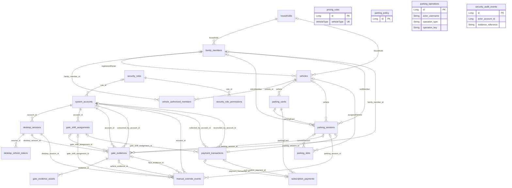
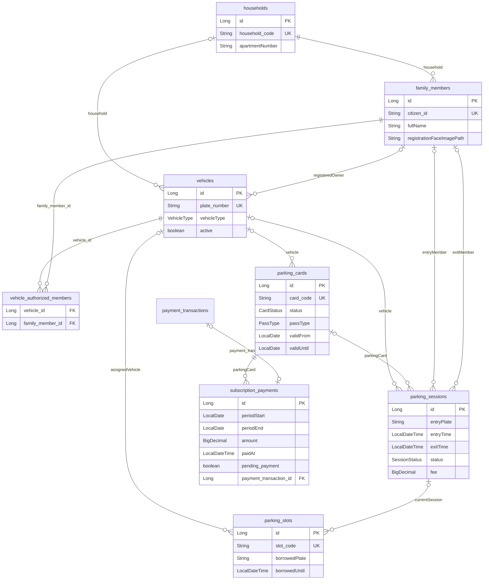
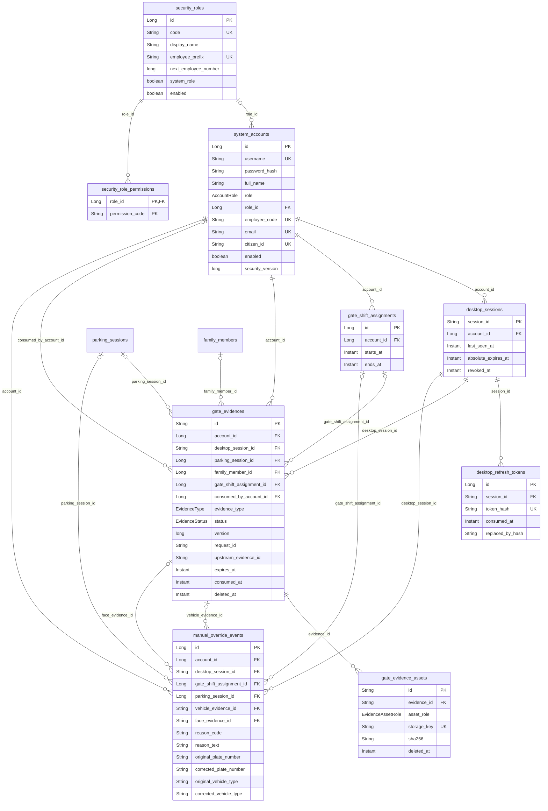
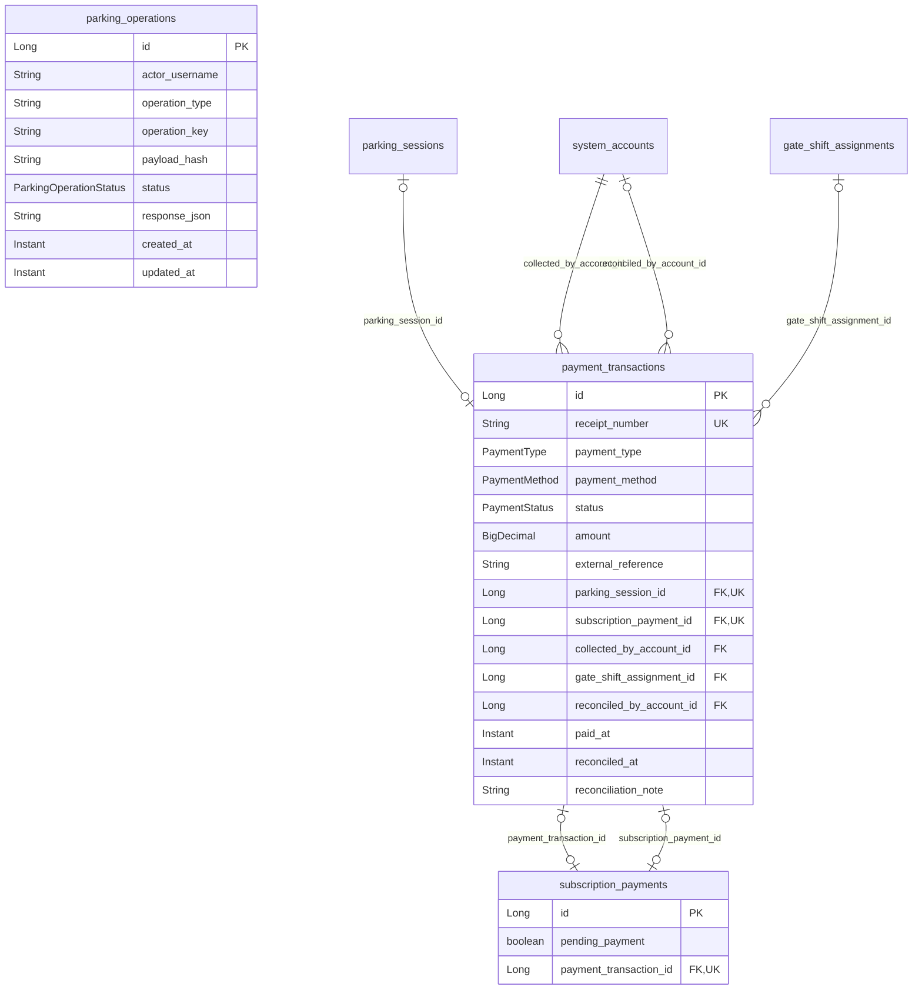

# ERD hiện tại theo entity và SQL source

[Database/lifecycle](database.md) · [Data dictionary](data-dictionary.md) · [Kiến trúc](system.md)

## Phạm vi và ký hiệu

Sơ đồ bao phủ **20 JPA entities và hai bảng nối/collection** trên `main` (`abd6183`). Nguồn là các lớp trong [domain](../../spring-web/src/main/java/vn/edu/parking/domain/) và [SQL scripts](../../scripts/database/), không phải introspection DB thật. PK/UK/FK mô tả metadata/DDL source, không chứng nhận scripts đã áp dụng hoặc constraints trên MySQL hiện tại. Chi tiết mọi field ở [data dictionary](data-dictionary.md); diagram dùng subset field để giữ khả năng đọc, không bỏ entity khỏi inventory.

- `||`: đúng một; `o|`: không hoặc một; `o{`: không hoặc nhiều.
- Với nghiệp vụ, tên quan hệ là Java property; các FK SQL không được đặt tên tường minh không được tự đoán tên cột.
- Nhóm security/evidence/payment có tên join columns tường minh. GateEvidence hiện là quan hệ JPA LAZY, không còn model scalar IDs của tài liệu legacy.
- Audit actor/evidence references, refresh `replaced_by_hash`, evidence `upstream_evidence_id` và operation `actor_username` là scalar/logical references, **không có FK khai báo**; không vẽ thành FK.
- Với OneToOne payment, phía parent có 0..1 ledger row; các source link nullable nhưng SQL CHECK yêu cầu đúng một trong hai nguồn. Hai chiều subscription/payment là hai join columns riêng, không `mappedBy`.

## Tổng quan quan hệ

PricingRule được tìm bằng VehicleType, ParkingPolicy được tìm bằng id; không có FK Session→PriceRule/Policy. Audit cố ý có thể giữ actor/reference sau khi trạng thái nghiệp vụ thay đổi; không suy ra một quan hệ JPA hoặc ON DELETE policy từ tên field.

## Nghiệp vụ và bảng nối

Bảng nối biểu diễn quyền theo **từng xe**, không quyền mọi xe trong hộ. Không gán PK/unique pair cho bảng nối khi source chưa khai báo rõ. Slot.currentSession và assignedVehicle là ManyToOne, không tự có unique một-một. Guest là session.vehicle null, không có cột enum VISITOR. Phiên gửi xe dùng OPEN/COMPLETED/CANCELLED; PREVIEW là response, không DB state.

## Tài khoản, phiên Desktop và bằng chứng nhận dạng

Phase2/phase4 evidence SQL khai FK RESTRICT, riêng shift references của evidence/override SET NULL; shift→account RESTRICT. Dynamic-RBAC SQL khai account.role_id nullable/FK RESTRICT, role permissions CASCADE. `permission_code` không FK tới catalog riêng. File bytes ở private filesystem, metadata/digest ở asset rows, không BLOB ảnh. Evidence TTL/single-use khác retention; không hold-approver/finite-preservation fields trong main. Kiểm quyền và retention là service policies, xem [security](../security/overview.md).

## Thu tiền, đối soát và operation replay

SQL payment CHECKs: đúng một session/subscription source, amount>=0; source/actor FK RESTRICT, shift SET NULL. Operation UK là **composite** `(actor_username,operation_type,operation_key)`, không từng field riêng. ParkingOperation không FK tới session/account; response JSON là replay result, không domain relation. Payment enum VOIDED/REFUNDED không chứng minh có refund workflow. Desktop outbox nằm ngoài DB, không nằm trong ERD.

## Legacy và giới hạn kiểm chứng

Mô tả V1–V6 Flyway, `gate_evidence` singular, scalar owner IDs/hold/processing-outage fields là **legacy nhánh trước**, không được vẽ như schema main. Main có scripts thủ công và Hibernate update, không Flyway dependency/directory. `manual_override_allowed` là cột legacy được phase4 SQL giữ lại nhưng không entity field hoặc input authorization hiện tại. `parking_card_code_migration_backup` là bảng backup của script chuyển card identifier, không entity ứng dụng. Không suy DB thật không có bảng khác.

Đã đối chiếu source/SQL tĩnh; chưa render Mermaid, chạy SQL/migrations/test/build hoặc introspect database trong lượt docs-only này. Cardinality/UK/FK source không chứng nhận deployment/concurrency/backup-restore.
