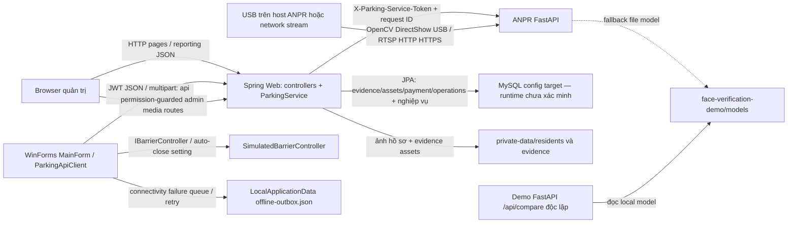

# Kiến trúc hệ thống — topology quan sát và ranh giới tích hợp

[Database](database.md) · [Phạm vi nghiệp vụ](../requirements/README.md) · [Traceability NV01–NV08](../requirements/traceability.md)

## Mục đích, phạm vi và cách đọc bằng chứng

Hệ thống hỗ trợ đăng ký hộ/người/xe/quyền, thẻ-gói-giá, trạm gác vào-ra, vị trí đỗ và báo cáo. AI hỗ trợ nhận biển/loại/mặt, không tự quyết quyền sử dụng xe. Chi tiết yêu cầu nằm trong tám NV, không thay đặc tả bằng diagram kiến trúc.

| Lớp bằng chứng | Ý nghĩa trong trang này |
| --- | --- |
| Kiến trúc yêu cầu | Mô hình cần đạt trong đặc tả; không chứng minh feature đã chạy |
| Code observed | Symbol/call path/mapping đọc tĩnh; không runtime hoặc deployment PASS |
| Test hiện diện | Assertions được đọc hoặc file được index, không tự suy ra executed |
| Not verified / conflict | Chưa xác minh end-to-end/runtime/source lineage; không tự thành “không có” |

Trang đối chiếu source của `main` (`abd6183`), không dùng backup dưới `.artifacts/` làm evidence hiện hành. Kết quả thực thi lịch sử được sở hữu tại [testing strategy](../testing/strategy.md), không xác nhận deployed runtime hoặc test main đã chạy. Policy còn mở nằm tại [decisions](../decisions/README.md).

## Thiết kế đề cương và topology thực tế

Thiết kế yêu cầu Web/WinForms dùng chung Spring REST, MySQL/AI, controlled storage, RBAC/audit và recovery/resync. Các khái niệm đề xuất như RecognitionResult/FaceTemplate/Alert không tự là entity; main đã có PaymentTransaction, GateEvidence/assets và ParkingOperation nhưng không đồng nghĩa đáp ứng toàn mô hình yêu cầu. Desktop processing qua Spring, không gửi trực tiếp AI. Main có local outbox/replay support; đây không phải offline admission hay guaranteed resync.

Gate call path: **Desktop → Spring `/api/ai` → ANPR** cho image/video/camera OCR và face capture/verification; **Desktop → Spring `/api/parking`** cho lookup/entry/exit/slots. Spring uses repositories/JPA and private filesystem, reads server resident references or consumed guest entry-face assets, forwards `X-Parking-Service-Token`, then creates server-owned evidence IDs. Source/test presence is not live service/database/camera/deployment evidence.

Diagram dựng từ source, không từ render thesis; arrows không chứng minh deployment đã chạy. Resident và evidence files ở hai subtree private, không static `/uploads/**`. Không có gate→demo API. DB node ghi target config MySQL, không chứng nhận operational engine/schema.

## Thành phần và trách nhiệm

| Thành phần / evidence | Vai trò và giới hạn |
| --- | --- |
| [Spring entry point](../../spring-web/src/main/java/vn/edu/parking/ParkingWebApplication.java); [pom](../../spring-web/pom.xml) | Spring Boot3.5.5/Java21/Web/Thymeleaf/JPA/Validation/Security/OAuth2 resource server; MySQL runtime driver, H2 test-only; no Flyway dependency |
| [ParkingApiController](../../spring-web/src/main/java/vn/edu/parking/web/ParkingApiController.java) | Entry/preview/confirm/OPEN/lookup/slots/dispatch/borrowing/batch/unassigned/health; entry/confirm wrapped by ParkingIdempotencyService. AI routes belong to AiProxyController, not this controller |
| [ParkingService](../../spring-web/src/main/java/vn/edu/parking/service/ParkingService.java) | Transactional session/fee/slot flow, GateEvidenceConsumptionService, ManualOverrideService, PaymentTransactionService. Controls have explicit legacy/config branches and gaps described below |
| [AdminController](../../spring-web/src/main/java/vn/edu/parking/web/AdminController.java); [PaymentController](../../spring-web/src/main/java/vn/edu/parking/web/PaymentController.java) | Registration/dashboard/history/revenue/cards and receipt/collection/reconciliation; controller source does not certify all workflows or external settlement |
| [Desktop project](../../desktop-winform/ParkingGateDesktop.csproj); [Program](../../desktop-winform/Program.cs) | .NET8 Windows/WinForms; DesktopApplicationContext manages login/MainForm lifecycle, not direct anonymous MainForm startup; Windows target |
| [ParkingApiClient](../../desktop-winform/ParkingApiClient.cs) | Spring default localhost:8080, login/refresh/origin-bound JWT requests, `/api/ai` health/processing and durable entry/confirm outbox. No AnprApiClient.cs exists on main; do not direct Desktop to localhost:8001 |
| [AiProxyController](../../spring-web/src/main/java/vn/edu/parking/web/AiProxyController.java); [AiProxyService](../../spring-web/src/main/java/vn/edu/parking/service/AiProxyService.java) | `/api/ai` image/video/camera/face/guest-face/health; proxy validation/forwarding and GateEvidenceService persistence; no AnprServiceClient on main |
| [ANPR main](../../anpr-service/app/main.py); [internal_auth](../../anpr-service/app/internal_auth.py) | FastAPI service version4.0-robust-liveness, cached recognizer warm-up and face/camera handlers. Only health/favicon public; header token on processing. Direct ANPR OCR caps25MiB image/250MiB video, different from stricter Spring10MiB/25MiB and servlet10MB per file. No relational persistence here |
| [Recognizer](../../anpr-service/app/recognizer.py):41–139 | YOLO biển + vehicle, EasyOCR, normalize, confidence/box/frame/annotated base64; CAR/MOTORBIKE/UNKNOWN và fallback hình biển, không six-category/EV-accuracy proof |
| [FaceEngine](../../anpr-service/app/face_engine.py):10–38,85–165 | YuNet/SFace, threshold decision và compare_best nhiều frames/CLAHE; model fallback và RLock native-state, không gate event lock |
| [Demo app](../../face-verification-demo/app.py):16–29,207–265 | UI/API độc lập, `/api/compare` nhận CCCD/registration/realtime và ba score; trả livenessChecked=false, không integrated gate enrollment proof |
| [ResidentImageStorage](../../spring-web/src/main/java/vn/edu/parking/service/ResidentImageStorage.java); [PrivateEvidenceStorage](../../spring-web/src/main/java/vn/edu/parking/service/PrivateEvidenceStorage.java); [GateEvidenceService](../../spring-web/src/main/java/vn/edu/parking/service/GateEvidenceService.java) | Shared configurable private root (default private-data), separate residents/evidence subtrees. Resident JPEG re-encoding; evidence JPEG/PNG/digests. GateEvidence/assets model, TTL10min, retention30days separate. No GateEvidenceStorage or FaceVerificationPolicy classes on main |
| [GateEvidenceAdminController](../../spring-web/src/main/java/vn/edu/parking/web/GateEvidenceAdminController.java); [GateEvidenceRetentionService](../../spring-web/src/main/java/vn/edu/parking/service/GateEvidenceRetentionService.java) | Permission-guarded metadata/asset admin reads and audited cleanup. Retention skips OPEN, no finite holds; scheduled cleanup defaults off. Storage encryption/backup/restore/runtime paths unverified |
| [OfflineOutboxStore](../../desktop-winform/OfflineOutboxStore.cs); [BarrierController](../../desktop-winform/BarrierController.cs); [GateStationSettings](../../desktop-winform/GateStationSettings.cs) | Local JSON queue, simulator-only barrier interface, USB/network camera sources and auto-close settings; no physical driver or offline authorization guarantee |

## Luồng dữ liệu nghiệp vụ quan sát

| Luồng / call path | Dữ liệu / quyết định / giới hạn |
| --- | --- |
| Recognition: [MainForm](../../desktop-winform/MainForm.cs) → [ParkingApiClient](../../desktop-winform/ParkingApiClient.cs) → AiProxyController → AiProxyService → ANPR | Image/video or camera source; Spring checks uploads/response contractVersion1.0/requestId/modelVersion, normalizes plate, stores annotated-image asset and returns its own evidenceId (upstream ID separately retained). It does not retain all original input/video frames. Evidence READY/TTL/identity checks occur on gate consumption |
| Lookup: MainForm.LookupResidentAsync → ParkingApiClient → controller lookup | Vehicle/card/pass and active authorized-member IDs/names/face-image-available; no registration image paths or guest evidence reference returned. Lookup display does not replace authorization checks |
| Resident face: ParkingApiClient `/api/ai/face/verify-camera`, `/verify-image`, `/verify-video` → RegisteredFaceService → proxy | Spring loads selected member's stored reference, sends bytes (not client URL), stores upstream decision/similarity/thresholds plus realtime asset. RegisteredFaceService.load does not check active/per-vehicle authorization; ParkingService verifies active authorized driver on entry. No Spring FaceVerificationPolicy recomputation or obligatory link to a recognition evidence ID in this path |
| Guest face: `/api/ai/face/capture-camera` and `/face/guest/verify-*` | ENTRY capture creates FACE/CAPTURED evidence; optional at entry. GuestRegisteredFaceService uses EXIT vehicle evidence plate→OPEN guest session→consumed ENTRY FACE asset as comparison reference. Final consumption validates type/operation/owner/session/member, not a stored cross-link between the EXIT face result and that specific OPEN session |
| Entry: client → ParkingApiController → ParkingIdempotencyService → ParkingService | Default requires READY/unexpired server evidence, derives plate/type/face decision, plate-as-card lookup, driver check, OPEN/session/evidence consumption/manual event/slot assignment. Legacy no-evidence path exists only when required=false; warning card/pass cases still create OPEN. Vehicles without any authorized-member face profile have a legacy no-selected-driver path |
| Exit preview/confirm | Preview reads without consume/bind. Confirm consumes evidence under row locks, stores COMPLETED/fee/exit-face, positive-fee receipt, override audit and clears slot transactionally. Guest stored face requires PASS unless approved manual correction; resident exit face optional. `exitMember` is not populated by confirm |
| Manual correction: ManualOverrideService | AI_RESULT_CORRECT or legacy gate eligibility, active account/Desktop/shift, both evidence types, reason/text validation; original/corrected plate/type and approved/rejected events. Supported reasons include plate/type correction, REVIEW/FAIL/CAPTURED face cases, not the old three-case outage policy |
| Pricing: ParkingService.calculateFee/hasValidMonthlyPass → PricingRuleRepository | Type/session dates/card hiện tại; monthly eligibility dùng ngày entry + ACTIVE hiện tại; không payment settlement hoặc historical-rule snapshot |
| Payment/reporting: AdminController + PaymentController + shift summary services | Positive exit fee and monthly subscription collection create PaymentTransaction receipts/method/reference/collector/shift; reconciliation records actor/note/time. Dashboard session/subscription aggregation and ledger reports have different bases; neither proves external settlement or known-total accounting correctness |
| Slots: ParkingApiClient slot methods → ParkingApiController slot routes → ParkingService slot methods | Assignment/borrowing/status/release/dispatch/batch/unassigned; không physical occupancy sensor hoặc charging station integration |

Family rights theo **từng xe**, không tất cả xe trong hộ. Evidence model/lifecycle and legacy branches are detailed in [database](database.md). Mandatory resident exit face, strict every-entry face and generic payment exemption are not inferred from UI or entity presence. Source CLOSED differs from code COMPLETED; enum names are not proof of NV acceptance.

## Synchronous dependencies và failure boundaries

- Synchronous HTTP remains; no broker is observed. AiProxyConfiguration defaults connect5s/read5m (not a45s end-to-end deadline). Desktop uses per-request cancellation: ordinary10s, recognize-camera30s and face-camera2min; timeouts differ from Spring and are not an SLA.
- Camera sources support USB index and bounded RTSP/HTTP/HTTPS URI. OpenCV USB uses DirectShow on ANPR host; network streams are opened there, not on Desktop. Per-source locks (hashed key for network) serialize camera capture, not DB events. URI credentials/network reachability need deployment controls; no physical camera integration was run.
- Resident writes re-encode JPEG; evidence stores bounded JPEG/PNG assets. Temp-write/rename and local exception deletion exist, but filesystem is not DB-enlisted. Crash/late commit/file cleanup/barrier partial failures remain recovery boundaries.
- Entry/confirm operationId supports server cached replay scoped actor/type/key/payload hash; missing key bypasses. Main local outbox queues connectivity/I/O/cancellation failures, preserves requests/IDs and retries sequentially, stops on first failure. It rejects inline face bytes but retains request metadata unencrypted in JSON, is not account/origin-partitioned, and evidence TTL/session ownership can block replay. No offline gate admission or guaranteed eventual sync follows.
- IBarrierController is implemented only by SimulatedBarrierController; station settings accept SIMULATOR only. Auto-close default5s/configurable1–120s is UI-side state, not physical feedback, safety interlock or transactional DB coupling.
- Warm-up runs recognizer on a black frame; missing dependencies/weights may block startup. FastAPI `/health` reports status/service/version/modelLoaded/faceModelsReady (faceModelsReady checks model-file existence). Spring `/api/parking/health` reports status/service/version/database, attempts JDBC metadata and falls back to Unknown while still returning UP on failure. Neither endpoint proves camera/JWT/readiness/live E2E; the old missing-version/service contract claim is not applicable to these main response bodies. See [operations](../operations/setup-and-troubleshooting.md).

## Security và trust boundaries

[SecurityConfig](../../spring-web/src/main/java/vn/edu/parking/config/SecurityConfig.java) and [DesktopApiSecurityConfig](../../spring-web/src/main/java/vn/edu/parking/config/DesktopApiSecurityConfig.java) separate Web session/CSRF and stateless JWT for `/api/auth`, `/api/ai`, `/api/parking` except revenue. Dynamic role grants coexist with legacy ROLE_MANAGEMENT compatibility/fallback; no blanket claim that enum roles are ignored. Admin media routes require PRIVATE_EVIDENCE_VIEW or legacy management, audit and no-store. `/uploads/**` is not exposed by an allow rule/resource handler. H2-console matcher is permitAll in Web chain, though H2 driver is test-only; do not describe it as denied or available runtime without configuration evidence.

Default required evidence prevents no-evidence processing; with supplied IDs Spring derives decisions rather than trusting client face booleans. Explicit required=false/no-ID compatibility path does trust legacy request fields, so unconditional “rejected” claims would be inaccurate. Consume validates owner/Desktop session/type/operation/TTL/member, uses pessimistic lock and evidence @Version. Manual corrections use AI_RESULT_CORRECT and active shift, not OVERRIDE_CREATE/outage evidence. Face decision/threshold is taken from trusted upstream response, not independently computed by an absent policy class. Actual controls/gaps do not redefine approved NV policy.

Source-contract gaps remain: FACE_FAILED validation expects `FAIL`, while FaceEngine returns `REJECT` below review threshold; PLATE_NOT_DETECTED exists as a reason, but createVehicle requires nonblank plateText before issuing evidence. Do not claim these reason branches work end-to-end merely because their enum/UI options exist. SecurityRoleBootstrap also restores MANAGEMENT's complete permission set at startup and backfills missing role/employee codes; it is not a no-write configuration reader.

Resident media save bounds bytes/dimensions, decodes and re-encodes JPEG into private residents subtree. Reads allowlist UUID jpg/png names, reject final symlink/nonregular/oversized files; non-private references use legacy root, not remote URL fetch. Evidence storage preserves valid JPEG/PNG with SHA verification. Admin asset route scopes asset ID to evidence ID, not to current operator-owned OPEN session; do not import that legacy route policy. Retention uses createdAt30days, batch100, skips OPEN and soft-marks deletions; scheduling defaults off, no finite holds/orphan sweep guarantee. Liveness score is computed but not surfaced/used to override face match, and Spring evidence remains NOT_EVALUATED by current creation logic. Demo three-image flow is separate, not biometric/liveness accuracy proof.

## Runtime configuration và deployment assumptions

| Evidence | Cấu hình / boundary |
| --- | --- |
| Spring pom; [application.properties](../../spring-web/src/main/resources/application.properties); entry point | Tracked properties (no application.yml), Java21/MySQL dialect/driver, external DB placeholders, Hibernate update/open-in-view=false. JWT defaults true via PARKING_SECURITY_JWT_ENABLED, external RS256 keys/issuer/audience/kid; no Flyway dependency/directory |
| [run-web-laragon.ps1](../../scripts/run-web-laragon.ps1) và [run-all-laragon.ps1](../../scripts/run-all-laragon.ps1) | Launcher DB label/probe/environment không proof Spring chọn datasource; không chép credentials/env values. Không re-run launcher |
| ResidentImageStorage/PrivateEvidenceStorage; properties | PARKING_PRIVATE_STORAGE_PATH default private-data; residents/evidence subtrees. PARKING_UPLOAD_DIR default uploads only legacy resident reads. Evidence required defaults true, retention30days, scheduled cleanup false; TTL default10min in service. Relative roots depend on process working directory, runtime paths/backups unverified |
| ParkingApiClient; AiProxyConfiguration; FastAPI internal_auth | Desktop default Spring localhost:8080. PARKING_AI_BASE_URL default http://127.0.0.1:8001; PARKING_INTERNAL_SERVICE_TOKEN sent in X-Parking-Service-Token. FastAPI accepts current/previous token for rotation, missing configuration503/wrong token401. No old ANPR_SERVICE_TOKEN/internal-Bearer contract or weak-token-length validation should be invented from prior branch source |
| [ANPR requirements](../../anpr-service/requirements.txt):1–8, recognizer:58–73 | FastAPI/Uvicorn/YOLO/EasyOCR/OpenCV/NumPy/Pillow; ANPR_PLATE_MODEL/ANPR_VEHICLE_MODEL/default models, ANPR_GPU, confidence env vars; availability/install/metrics không tested |
| FaceEngine:10–16 | YuNet/SFace trong ANPR models hoặc demo/models; FACE_MATCH_THRESHOLD/REVIEW/DETECTION defaults trong source, chưa hiệu chỉnh site camera |
| [Desktop csproj](../../desktop-winform/ParkingGateDesktop.csproj); GateStationSettings; ANPR main | Windows .NET8; USB DirectShow on ANPR host or network URI stream; simulator-only barrier. Remote deployment must review origins/model/private root/network-camera/token configuration; no client image URL fetch |

Demo là app ASGI riêng; conventional port8002 được project hướng dẫn mô tả, không hardcoded bind/integration từ app.py. Không tuyên bố container/network/TLS/production MySQL/H2 readiness, active profile hoặc credentials được cấp đúng từ các defaults trên.

## Test evidence, conflicts và câu hỏi còn mở

Static source references include [ParkingFlowIntegrationTest](../../spring-web/src/test/java/vn/edu/parking/ParkingFlowIntegrationTest.java), [DesktopJwtIntegrationTest](../../spring-web/src/test/java/vn/edu/parking/DesktopJwtIntegrationTest.java), [AiProxyServiceTest](../../spring-web/src/test/java/vn/edu/parking/service/AiProxyServiceTest.java), evidence/storage/manual/payment service tests and module Desktop/ANPR tests. Their existence/assertions are not executed PASS. The prior branch totals54/128, V1–V6 rehearsal, AnprServiceClientTest, Desktop12/ANPR10 are **legacy**, not current-main verification. This docs-only sync ran no build/test/service/DB/camera/dependency command; source comparison excludes artifact backups. No production MySQL concurrency, credentials, TLS, physical barrier or live model accuracy was verified.

- [P01/P08](../decisions/README.md): phạm vi sạc và authority học thuật chưa chốt; diagram trên từ source hiện tại. Không suy charging API/rights/hardware từ ParkingSlot/EV fuel.
- Mandatory resident exit face/rights, legacy no-face entry, warning OPEN, conditional guest face, full AI/liveness/CCCD checks, distinct-key concurrent sessions, outbox identity/expiry recovery, external payment settlement/refunds and privacy remain gaps despite added replay/receipt/manual-audit source.
- Production datasource/profile/schema init, startup runner applicability/order, models/camera/network/site thresholds, recovery/backup/retention và transaction-media integrity cần evidence. Xem [NV07](../requirements/nv07-exceptions-recovery.md), [NV08](../requirements/nv08-reporting.md) và [database](database.md); không đặt quy tắc mới để lấp chỗ thiếu.
