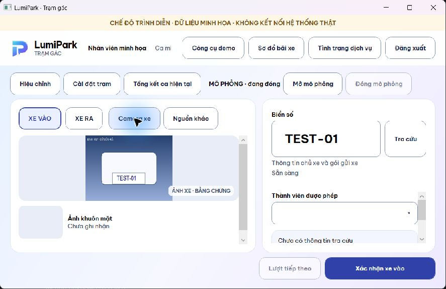
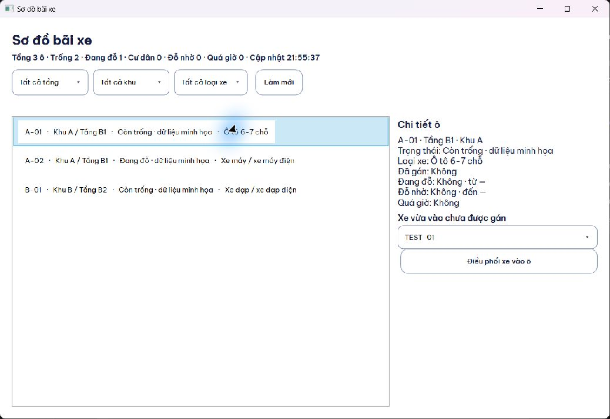
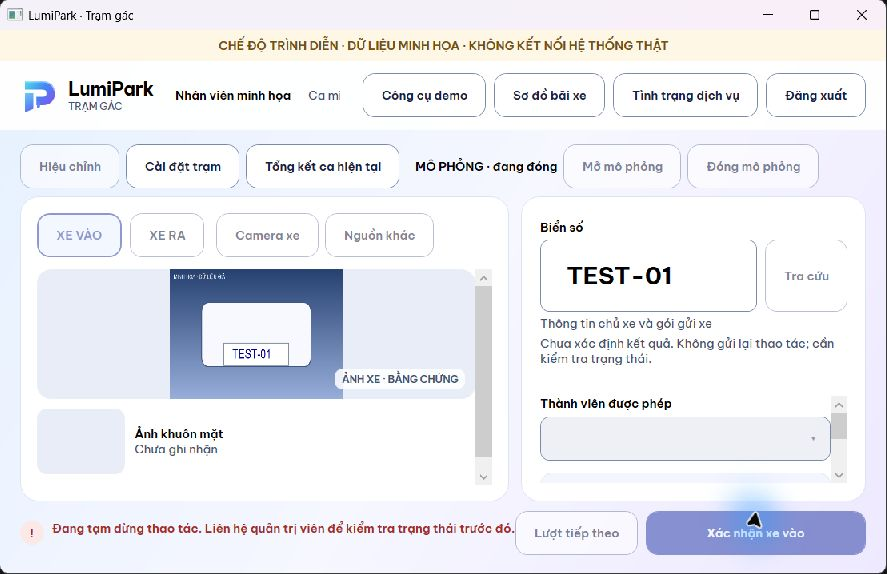
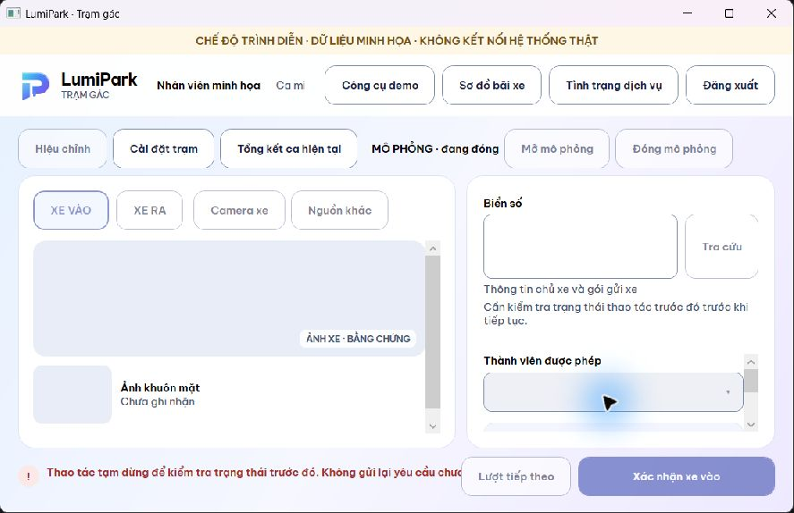

# LumiPark Desktop WPF — bàn giao triển khai

WPF + .NET 8 đã tích hợp các bề mặt đang exposed của WinForms và qua quality gate local. WinForms cùng launcher mặc định được giữ làm baseline. PR Desktop xếp trên nhánh Web khi PR Web #6 còn mở; không thay backend, schema, chính sách phí hoặc settlement. Review của con người là bước tiếp theo.

## Phạm vi và kiểm chứng

| Bề mặt | Triển khai | Bằng chứng và giới hạn |
| --- | --- | --- |
| Client/DTO/settings/outbox/barrier | `DesktopCore` liên kết source gốc WinForms | Core 76/76; WinForms 12/12; build cả hai ứng dụng |
| Login/session/heartbeat/ca/logout | Factory production riêng, không dữ liệu mẫu; guard lifetime và auth | Tests; native demo auth/session expiry ở slice trước, tổng kết ca trước ở lượt cuối |
| Xe vào/ra, media/ANPR/face, tra cứu | Client thật, context/revision chống kết quả cũ; xử lý ảnh nền, ảnh frozen có giới hạn | Fake HTTP/tests; native entry, camera tổng hợp và lookup ở slice trước; capture compact kiểm tra lại |
| Preview/payment/ref/receipt | Ticket theo context; xác nhận riêng, không global Enter | Tests validation/duplicate/late result; native cash-modal cancel. Bank/POS keyboard đầy đủ: NOT VERIFIED |
| Evidence/zoom/correction | Bốn ảnh, confidence khi có dữ liệu, zoom/pan; reason/type theo contract | Native đủ bốn ảnh; STA kiểm tra zoom extent và cửa sổ. Native zoom/correction đầy đủ: NOT VERIFIED |
| Sơ đồ/chi tiết/điều phối | Filter, tổng hợp toàn snapshot, hàng virtualized có key; safe dispatch theo session ID | Tests lỗi/refresh/race; native mở/chọn xe bằng Down/Enter, nhãn Việt, điều phối fixture thành công |
| Cài đặt/tổng kết/barrier | Settings copy/validate/save; previous/current summary; simulator dùng shared controller | Tests/STA; native previous summary. Save/cancel và timer simulator đầy đủ bằng native: NOT VERIFIED |
| Health/queue/journal | Chỉ đọc queue bằng inspection; entry/exit/dispatch chung gate | Tests giữ nguyên queue hỏng; native health open/close không khóa giả; Unknown và restart giữ khóa |

Root chạy độc lập, tuần tự, trên source cuối: **Core 76/76, WPF 43/43, WinForms 12/12**, 0 failure/skipped; hai build Release **0 warning/error**. TRX và logs giữ local tại `.artifacts/agent-work/desktop-wpf-migration/final-root/`. Không phải live E2E. Các lần build/test lỗi trước đó được giữ, không tính PASS; bản cuối đã sửa và chạy lại.

## Findings đã khép

- Phân biệt NotSent/Rejected/Unknown, không gửi lại business POST khi 401 hoặc mất phản hồi; transient refresh trước dispatch không tạo hold giả.
- Journal metadata bền trước send, cùng gate cho entry/exit/dispatch, giữ Unknown qua restart; không bỏ qua hold từ queue cũ/hỏng.
- Stale media/face, raw face sau đổi biển, duplicate submit, auth/summary/settings lifetime, close reentrancy và demo payload race.
- Nguồn camera/menu ở vùng compact luôn thấy; ảnh mới vừa viewport, input và hành động chính được giữ; evidence/receipt vẫn đọc được khi khóa nhập.
- Crash mở map do ItemTemplate/DisplayMemberPath; refresh task hoàn tất đồng bộ bị cache; callback sau đóng/logout; selected ComboBox lộ DTO.
- Health đọc queue không thay file; concurrent inspection không tạo khóa giả. Kiểm tra native đã phát hiện các lỗi map/ComboBox/health mà build đơn thuần chưa bắt.

UI UX Pro Max được áp dụng cho review vận hành/compact và async WPF. Logo giữ đúng bốn path/gradient Web, Be Vietnam Pro nhúng kèm OFL; token semantic theo Web. Một số cặp chữ/nền chính đo contrast 7,17–14,24:1; không phải chứng nhận toàn bộ accessibility.

## Ảnh Windows thực tế

Ảnh tổng hợp, không dữ liệu vận hành; Windows DPI thực tế **125%**, workspace **900×580 logical**. Prototype là lịch sử, không thay bằng chứng bản hiện hành.

| Compact và ảnh xe | Sơ đồ và lựa chọn xe |
| --- | --- |
|  |  |

| Unknown sau 503 | Giữ khóa sau restart |
| --- | --- |
|  |  |

Native đã quan sát focus của menu và ComboBox, Escape đóng menu, Down/Enter chọn xe không tự dispatch. Không khẳng định mọi shortcut/dialog đã kiểm tra. Health fixture hiển thị Spring chưa hoạt động do public health request đi qua auth guard của demo handler; đây là giới hạn fixture, không kết luận dịch vụ production hỏng.

## Hiệu năng và giới hạn

Sample cuối: `ContentRendered` **378,78 ms**, working set **106,33 MiB**, private **68,37 MiB**, DPI125%,900×580. Chỉ đo dựng cửa sổ từ trước constructor; không phải cold start/auth/AI/E2E. Mẫu prototype và shell cũ khác workload, nên **NOT VERIFIED** cho cải thiện trước/sau tương đương hoặc frame-time. Không có tuyên bố tăng tốc định lượng.

I/O/ảnh được đưa ra tác vụ nền, decode có bound và frozen, map virtualized, refresh single-flight, async context/lifetime có regression tests. Không thêm hiệu ứng hoặc migration công nghệ để tối ưu chưa đo.

**BLOCKED — authoritative recovery:** chưa có API/quy trình đối soát được duyệt theo mã thao tác. WPF giữ Unknown và khóa giao dịch tiếp theo; không tự replay, xóa, resolve hoặc đoán thành công. Tra biển số/refresh map không đối soát. Native restart giữ nguyên SHA-256 của journal; journal chỉ có OperationId/Kind/Time/Origin/ActorFingerprint, không body/ảnh/token. WinForms giữ durable outbox cũ.

Giới hạn contract dùng chung có sẵn: xác nhận xe ra gửi biển số/mã thẻ; server tự chọn phiên và tính lại phí, không có expectedSessionId/expectedFee. Ticket chỉ bảo vệ ngữ cảnh local; receipt hiển thị kết quả server. Không khẳng định đã giải quyết thay đổi đa trạm/mốc phí; sửa contract cần quyết định riêng.

**NOT VERIFIED:** camera/AI/biometrics thật, MySQL vận hành, settlement/provider, barrier phần cứng, DPI100/150, Narrator/High Contrast/nhiều monitor; các native journeys chưa nêu rõ đã kiểm tra ở bảng trên.

## Chạy, CI và Git

Lệnh build/test/demo: [README WPF](../../desktop-wpf/README.md). Workflow `Desktop WPF` mới chạy Core/WPF/WinForms tests và build hai ứng dụng trên Windows khi PR đổi các đường dẫn Desktop. Kết quả GitHub CI phải xem thực tế trên PR, không suy từ local PASS. Workflow Verify cũ vẫn chạy thủ công. Lượt CI đầu có Workspace PASS nhưng smoke STA WPF vượt deadline toàn bài 5 giây; deadline được tăng có giới hạn lên 30 giây, giữ nguyên assertion/lifecycle và root targeted 1/1 PASS. Kết quả chạy lại xem trên PR.

AGENTS.md local và hai property override được bảo toàn ngoài commit. Không đưa `.opencode`, artifacts/logs/TRX, fixture/journal, credentials hoặc media vận hành lên Git; các PNG ở đây là dữ liệu tổng hợp đã chọn cho tài liệu. Không merge hoặc deploy.
