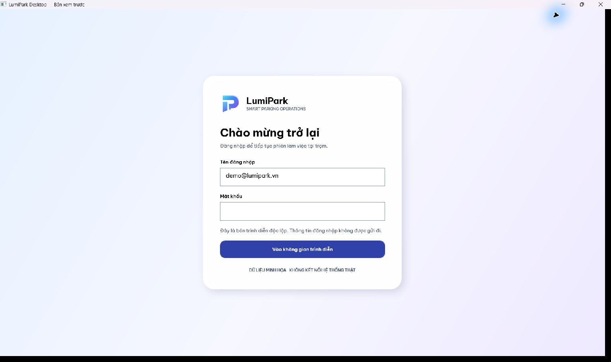
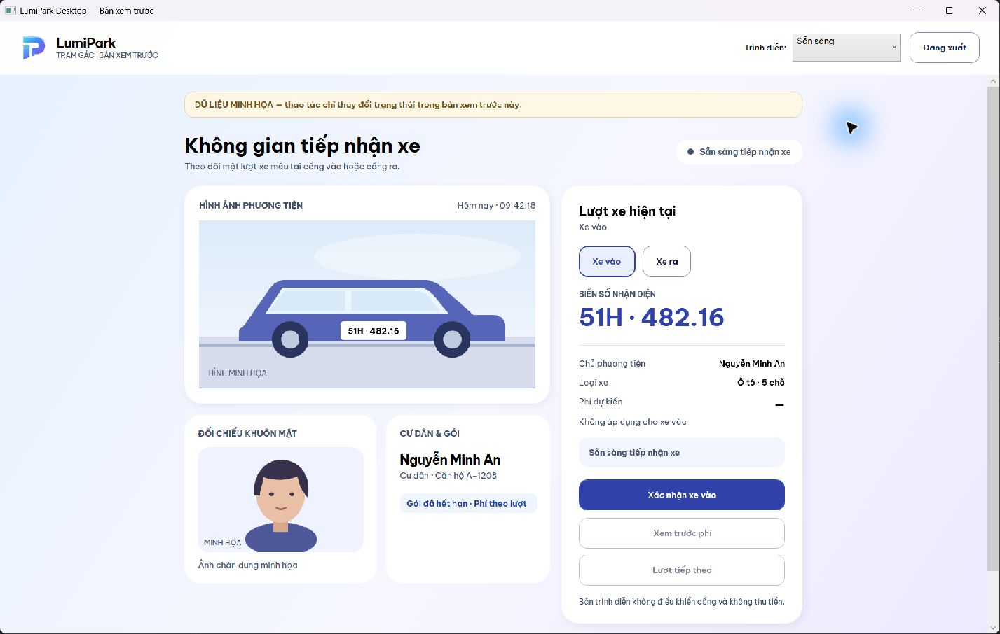
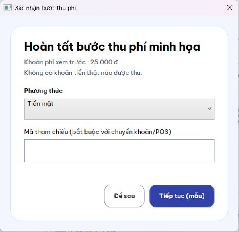
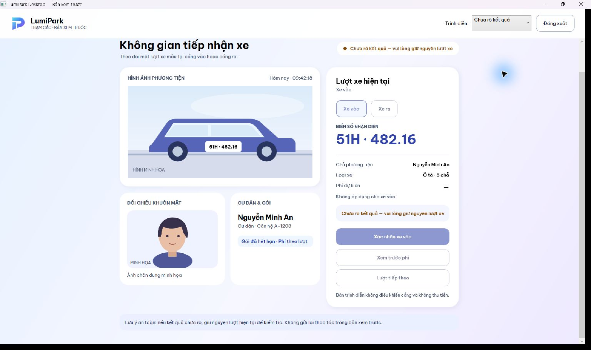
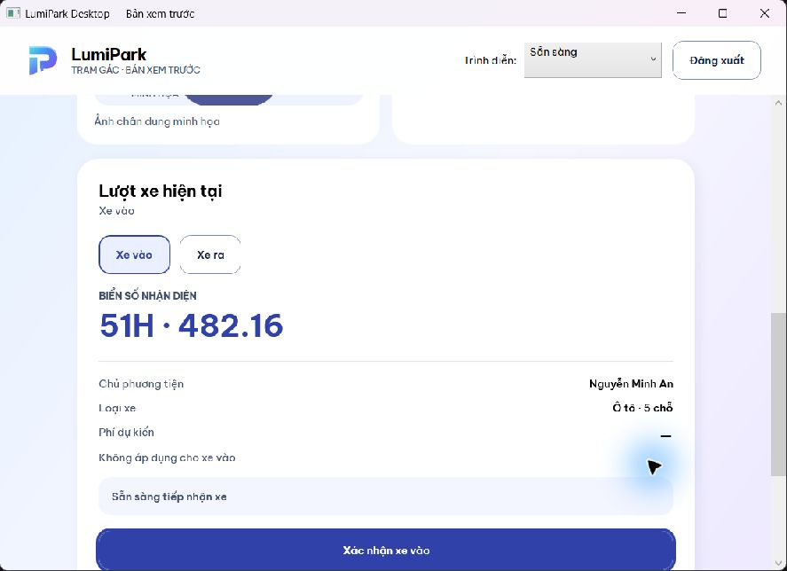

# LumiPark Desktop WPF — Prototype Visual Review

**03/11/2026 · HISTORICAL PROTOTYPE — DIRECTION APPROVED.** Chủ dự án đã duyệt WPF/nhận diện/hướng thiết kế và cho phép tiếp tục full implementation đến PR; không còn điểm dừng duyệt UI từng slice. Báo cáo dưới giữ nguyên bằng chứng và giới hạn của lượt prototype, không phải trạng thái triển khai cuối.

Đã xây prototype **WPF + .NET 8 + XAML chạy thật**, không dùng HTML để thay bằng chứng. Chỉ dùng dữ liệu tổng hợp và xử lý trong bộ nhớ; không nối đăng nhập thật, API, camera, thanh toán, barrier hoặc operational queue/settings. Chưa full migration; chưa commit/push/tạo PR. Nhiệm vụ tổng thể còn tiếp tục sau khi chủ dự án duyệt trực quan.

## Phương án và ảnh thực tế

Kế thừa logo gateway cyan–blue–violet, Be Vietnam Pro, primary indigo/accent tím và canvas pastel từ LumiPark Web. Cards trắng phân lớp, radius mềm và shadow tĩnh nhẹ; dữ liệu trên bề mặt gần opaque, không blur liên tục. Native window chrome giữ khả năng resize/keyboard của Windows. Text vận hành tránh Spring/HTTP/API; phần kỹ thuật nằm trong tài liệu và diagnostics.

Các ảnh dưới được chụp trực tiếp cửa sổ WPF trên Windows; hình xe/chân dung bên trong là illustration tổng hợp, không phải ảnh camera hoặc dữ liệu cá nhân. Đây là **bằng chứng prototype**, không phải live E2E.

### Login

Card có chiều sâu trên nền pastel, dùng đúng logo/font. Đăng nhập mẫu không xác thực hoặc truyền credentials. Codex chỉ quan sát màn hình này, không nhập mật khẩu hoặc tự động đăng nhập. Trạng thái mẫu được mở bằng launch argument để kiểm tra các bề mặt độc lập.

### Bàn vận hành

Hai vùng ảnh, biển số, cư dân/gói và vùng quyết định. Xe vào/ra có selected state; nút xác nhận nêu rõ hướng. Sample gói hết hạn dùng phí theo lượt khi ra, không giả định người có gói hợp lệ vẫn phải trả phí. “Lượt tiếp theo” là thao tác tường minh, không tự clear sau 2 giây. Desktop WinForms cũ vẫn nguyên vẹn làm baseline.

### Thu phí

Preview phí chỉ đọc; confirm xe ra cần preview, rồi mới mở dialog. CASH/BANK_TRANSFER/POS được kiểm tra bằng fixture; chuyển khoản/POS thiếu reference bị chặn. Xác nhận mẫu đi qua một tác vụ chờ và kết quả lượt xe; không tuyên bố settlement riêng. Nút “Để sau”/Escape đóng dialog và chưa gửi xác nhận, không cho xe qua hoặc bỏ phí.

### Chưa rõ kết quả

Trạng thái amber có text rõ; nút gửi, đổi hướng và lượt tiếp theo bị khóa. Chỉ menu **Trình diễn** được phép chuyển sang kịch bản mẫu khác. Không có replay, “đánh dấu đã xử lý” hay đường bypass nghiệp vụ. Recovery thật vẫn cần policy được duyệt.

### Cửa sổ nhỏ và bàn phím

Đã mở native WPF ở **900×650 logical pixels**, thực tế layout rounding thành 900×650.4 tại DPI125%. Nội dung xếp dọc và cuộn; Tab đưa bộ chọn hướng rồi nút xác nhận vào tầm nhìn, focus vẫn hiện rõ. Đã kiểm thêm native Maximize từ cửa sổ nhỏ trở lại bố cục ngang. **Trade-off:** compact cần cuộn giữa ảnh và vùng quyết định; chưa tối ưu thành vùng quyết định cố định. Chủ dự án cần duyệt lựa chọn này trước mở rộng migration.

## Kiểm chứng độc lập

| Hạng mục | Kết quả và giới hạn |
| --- | --- |
| Release build từ Codex | PASS, 0 warning/error, target `net8.0-windows`; không có dependency UI/NuGet mới |
| Focused state self-test từ Codex | **12/12 PASS**, JSON report riêng; không dựa vào exit code hoặc báo cáo Builder đơn lẻ |
| Pending thật của fixture | Tác vụ chờ900ms hiển thị pending, nút gửi disabled; cửa sổ vẫn được quan sát/tương tác. Không chứng minh mục tiêu100/200ms |
| Success | Kết quả được giữ, “Lượt tiếp theo” bật; không timer clear |
| Exit preview / modal | Preview không xác nhận; Enter khi thiếu bank reference hiện lỗi; Escape hủy, giữ lượt chưa xác nhận và trả focus về nút gửi |
| Keyboard | Tab main: menu trình diễn → đăng xuất → xe vào → xe ra → xác nhận; focus cuộn vào view ở compact. Chưa là accessibility certification |
| Error / lost connection / Unknown | Đã quan sát trạng thái giả lập, giữ dữ liệu, disabled đúng luồng; Unknown không mở hành động gửi lại |
| DPI / window size | Native **125%** xác nhận từ VisualTreeHelper; window1440×912 logical, compact900×650.4, native Maximize screenshot1536×912. OS DPI100/150 **NOT VERIFIED** |
| Logo | Bốn path SVG gốc xuất hiện nguyên vẹn trong DrawingImage; gradient MappingMode Absolute, tọa độ và stops giữ nguyên; không dùng P tự vẽ/teal–lime |
| Font | 4 weight TTF Regular/Medium/SemiBold/Bold, OFL1.1, Vietnamese cmap check không thiếu ký tự mẫu; đã đọc tiếng Việt trên cửa sổ thật. Không cài font hệ thống |
| Operational side effects | Prototype không dùng HttpClient/ParkingApiClient/operational paths; không POST nghiệp vụ hoặc gọi thiết bị |

12 test groups bao gồm: invalidation khi offline/Unknown; accepted-submit count chống gửi lặp; explicit next; stale direction completion; Unknown chặn mọi thao tác thông thường; coherence direction/success/fee; preview/cancel không submit; eligibility thanh toán; reference CASH/bank/POS; payment single-flight; logout; close. Tests sử dụng delayed fixture và state methods, không kiểm chứng backend idempotency hoặc đa trạm.

### Số đo hiện có

Một sample cửa sổ wide: construction→first `ContentRendered` khoảng **369.6ms**, working set khoảng **111.7MiB**, private bytes khoảng **86.3MiB**, CPU tích lũy0.5625s tại thời điểm sample. Compact có sample355.8ms ở kích thước khác. Đây không phải process-start/cold-start benchmark, CPU utilization%, median/p95 hoặc before/after comparison. Không kết luận compact nhanh hơn hoặc WPF nhanh hơn WinForms từ các sample này.

Baseline WinForms Task1 chỉ có login idle, không cùng fixture/workload. **Paired performance delta, 100ms feedback/200ms pending, ảnh lớn, map refresh và repeated-open resource behavior: NOT VERIFIED.** Tiếp tục đo khi có functional parity và harness tương đương; không tối ưu bằng cách giảm chất lượng ảnh/AI chưa được duyệt.

Narrator, High Contrast, nhiều monitor và DPI100/150, auth failure thật, camera/ANPR thật, settlement và physical barrier cũng **NOT VERIFIED**. Không đổi thiết lập Windows để tạo bằng chứng giả tương đương DPI.

## Finding-driven review

OpenCode là Builder chính: một lượt xây + một lượt targeted refinement, model catalog `openai/gpt-6-luna`; không thay config global hoặc agent local. Builder tự chọn skill/tools và self-check. Codex xem source và cửa sổ thật; một reviewer độc lập kiểm async/payment, sau đó kiểm lại phần sửa.

| Finding đã xử lý trong prototype | Căn cứ kiểm tra lại |
| --- | --- |
| Pending completion có thể đè offline/Unknown; survives logout/close | Generation invalidation + cancellation; focused tests và review độc lập |
| Exit submit bypass payment, preview lại xác nhận thu | Preview chỉ đọc; modal ở confirm; eligibility model + native modal/keyboard check |
| Unknown có thể nhận payment; tests cũ kiểm chưa đủ | Tests hiện từ chối Unknown/wrong direction/unpreviewed/duplicate, đếm accepted attempts |
| Chữ nút chính và hover thiếu contrast | Bỏ implicit foreground override, primary hover/pressed riêng; ảnh runtime đọc được |
| Logo gradient sai mapping | Reusable DrawingImage Absolute + source-path/stop comparison + native image |
| Illustration dùng sai tọa độ Canvas trong Grid | Canvas/Viewbox sửa vị trí bánh xe/chân dung; ảnh runtime |
| Success scenario đổi hướng mắc kẹt | Codex sửa completion coherence, thêm test group thứ12 |
| Compact/focus, hướng thao tác và tên control | Native compact/Maximize/Tab; selected modes, dynamic label, accessible names cho scenario/method/reference |

UI UX Pro Max được dùng thực chất: generator được đối chiếu và loại bỏ pattern marketing không phù hợp; WPF guidance về resources/pack URI, commands/state separation và async được chuyển vào resource dictionary, model eligibility và delayed fixture. Không dùng bộ framework MVVM lớn chỉ cho prototype. CodeGraph chưa trả đúng source WPF mới trong lượt thử; căn cứ cuối là source trực tiếp và runtime. Nguồn: [skill chính thức](https://github.com/nextlevelbuilder/ui-ux-pro-max-skill), [WPF control performance](https://learn.microsoft.com/en-us/dotnet/desktop/wpf/advanced/optimizing-performance-controls), [WPF typography](https://learn.microsoft.com/en-us/dotnet/desktop/wpf/advanced/typography-in-wpf).

## Giới hạn kiến trúc và bước sau duyệt

Prototype dùng model fixture riêng; **chưa** tách/reuse production API client hoặc đạt functional parity. Sau visual approval mới thực hiện việc đó theo từng slice: giữ client/auth/session/settings/models/outbox còn dùng được, tháo dependency System.Drawing/media preparation khi thực sự cần; dùng WPF binding/resources/commands phù hợp, không sao chép lại toàn bộ nghiệp vụ.

WinForms source/tests, launcher hiện hành, Web/backend và hai local properties overrides được giữ nguyên. `AGENTS.md` là thay đổi local do chủ dự án xử lý, không chỉnh trong nhiệm vụ này; hash vẫn khớp checkpoint. Build outputs được ignore trong project WPF.

**BLOCKED cho thay đổi recovery thật:** chưa chốt ai được xác minh/đóng Unknown, nguồn authoritative, replay sau đổi actor/origin/session hoặc evidence hết hạn. Chưa sửa replay/settlement/transaction/RBAC/barrier; prototype không giải quyết blocker này bằng text/disabled button. Các slice UI/read-only độc lập có thể làm sau duyệt; chưa được kết luận toàn bộ vận hành an toàn.

Nền Git vẫn `feature/desktop-ui-ux-redesign` từ Web`a4e175e`; PR#6 đang OPEN tại lượt xác minh, main`0bed157` chưa chứa Web. Khi tới GitHub handoff phải xác minh lại, dùng stacked base phù hợp nếu Web chưa merge. **Chưa commit/push/PR ở gate prototype.**

## Quyết định cần chủ dự án duyệt

1. Direction WPF premium: logo/font/màu Web, nền pastel và cards gần opaque, shadow tĩnh nhẹ.
2. Bố cục wide hai vùng ảnh + quyết định; compact xếp dọc/cuộn và focus tự vào view, hoặc yêu cầu ưu tiên vùng quyết định cố định ở bước tiếp.
3. Style và wording của login, bộ chọn vào/ra và dialog thu phí; chưa duyệt thêm nghiệp vụ.
4. Cho phép chuyển sang full migration theo slice sau visual acceptance; policy recovery còn giữ dependency riêng.

**Dừng tại điểm duyệt prototype. Không tự chuyển full migration hoặc xuất bản GitHub.**
